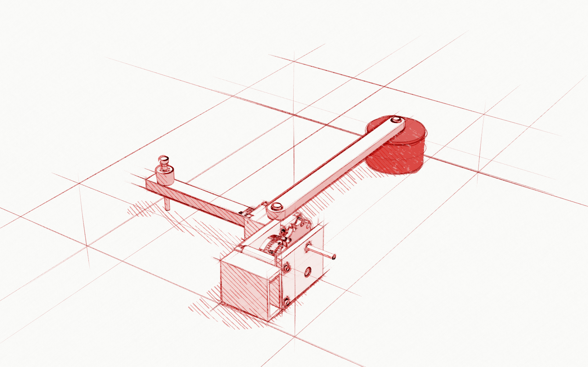
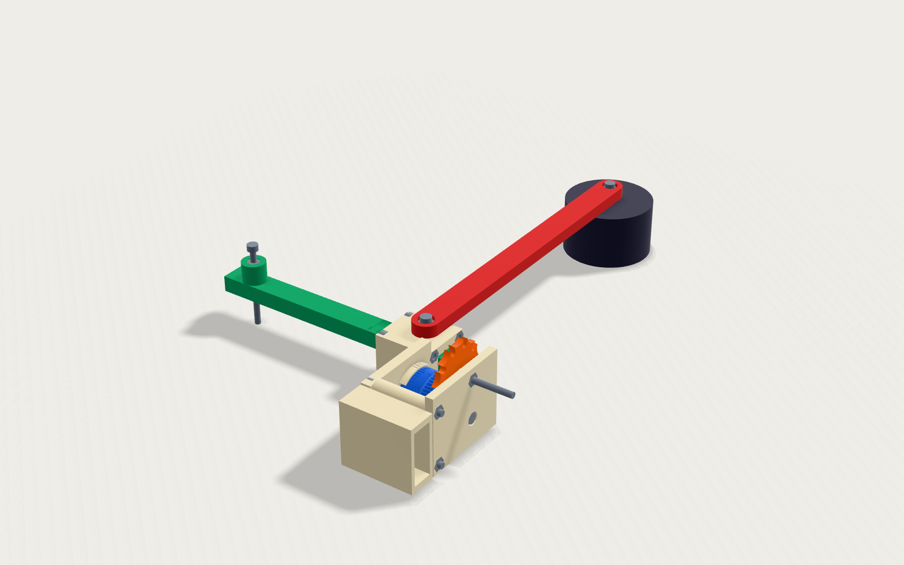
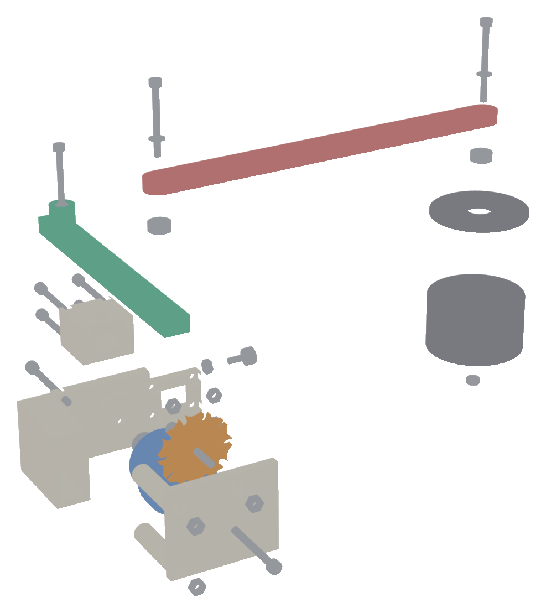
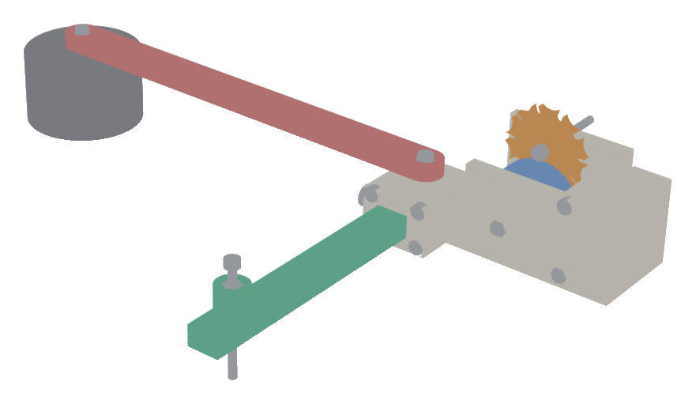
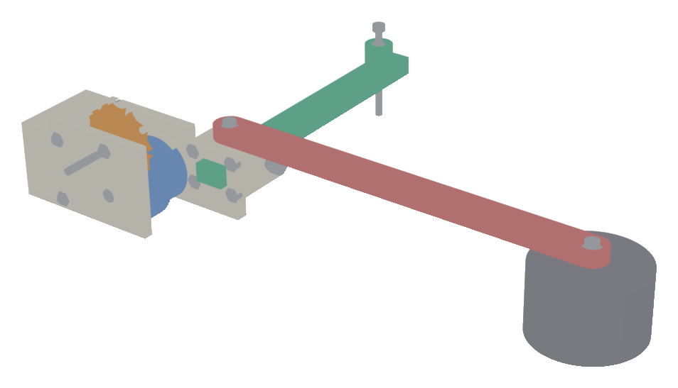
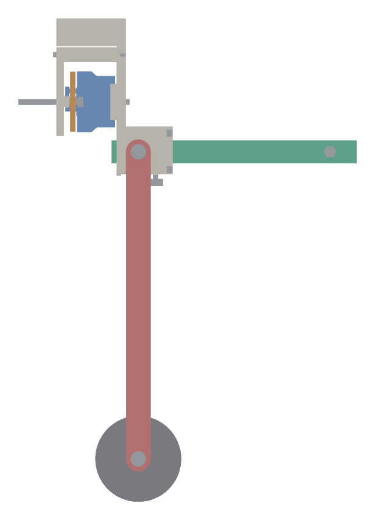
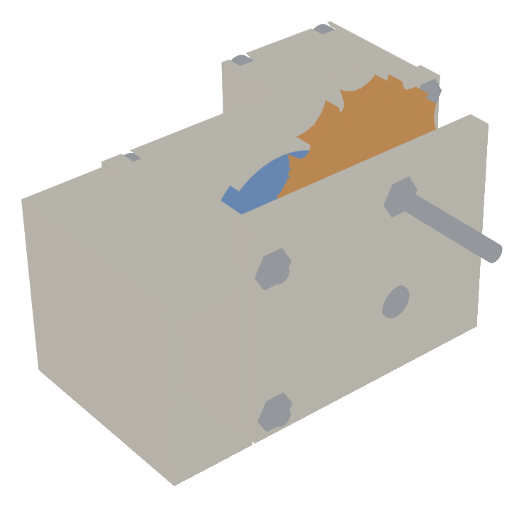
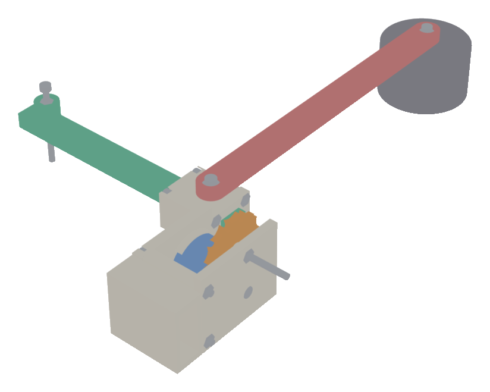

# Polar planimeter

A 3D-printable polar planimeter. Trace the outline of any shape with the tip, and the wheel counts the area.

<p align="center">
  
  
</p>

<p align="center">
  
</p>

With the pole outside the outline, the area is

```
A = L · s
```

where `L` is the tracer arm length and `s` is how far the wheel rolled. Here `L = 100 mm` and the wheel circumference is 100 mm, so one turn of the wheel is exactly 100 cm². The drum reads 2 cm² per division and a vernier gives 0.2 cm². A ten-slot Geneva counter tallies whole turns.

Everything is verified in CAD and simulation. **Nothing has been printed and tested on paper yet**, so expect to tune the fits with the coupon.

**Contents:** [`docs/planimeter.pdf`](docs/planimeter.pdf) is the full article, with the derivation, the mechanism design, the error budget and the build guide.

## Views

| | |
|---|---|
|  |  |
|  |  |
|  |  |

Exploded view colours: wheel blue, counter dial orange, tracer arm green, pole arm red, pole weight grey, printed carriage beige, hardware steel.

## Repository

| Path | Contents |
|---|---|
| `cad/` | CadQuery source. `params.py` holds every dimension; `build.py` regenerates everything |
| `stl/` | Print-oriented STLs, one per part |
| `step/` | STEP files for Fusion 360 or any CAD: one per part plus `planimeter_assembly.step` |
| `sim/` | Kinematic simulation, error budget and hand calculations |
| `docs/` | Article (LaTeX source and PDF), figures, sketch video |
| `tools/` | Preview and view renderers, printability report |

## Bill of materials

| Item | Qty |
|---|---|
| 623ZZ bearing (10 × 3 × 4 mm) | 4 |
| M3 bolts: 35 mm (axle, plate C ×2, pole), 25 mm ×4, 30 mm (dial, elbow), 40 mm (tracer) | 11 |
| M3 thumbscrew or short screw for the arm clamp | 1 |
| M3 nuts | 12 |
| 7 mm washers | 2 |
| Rubber feet, self-adhesive | 3 |
| Steel shot or washers for ballast (about 7 g) | 1 |
| Sewing pin (check rule) | 1 |

## Printing

<p align="center"></p>

PLA, 0.2 mm layers, 3 walls, 20% infill. Print `tolerance_coupon.stl` first and adjust `bearing_fit`, `arm_clearance` and `nut_clear` in `cad/params.py` if the bearings, arm or nuts do not fit. The STLs are already in print orientation.

| Part | Orientation | Supports |
|---|---|---|
| `wheel` | drum end down | none (40° skirt under the rim) |
| `carriage_a_block` | standing on end | none |
| `carriage_b_front_plate` | back face down | none |
| `carriage_c_rear_plate` | outer face down | none |
| `counter_dial` | flat, digits up | none |
| `tracer_arm`, `pole_arm`, `check_rule` | flat | none |
| `pole_weight`, `pole_weight_lid` | upright | none |

## Assembly

1. Press a 623ZZ into each end pocket of the wheel.
2. Pass the M3 × 35 axle through plate C, the wheel and plate B. Check that the wheel spins freely, then fix the nut.
3. Screw plate B to block A with the four M3 × 25 bolts, and join plates B and C with the two M3 × 35 bolts.
4. Fit the counter dial on its boss on plate C with the M3 × 30 bolt.
5. Press a bearing into each end of the pole arm. Fix one end to the pole weight and the other to block A at the elbow post.
6. Slide the tracer arm into the channel, set the tracer pivot to `L = 100 mm` on the scale and tighten the clamp screw. Put the three feet under the weight and add ballast to the plate B box.

`step/planimeter_assembly.step` shows the finished positions.

## Calibrate and use

Pin the check rule into a board and rest the tip in its cone seat. The circle it describes has an area of exactly 100 cm². Trace it once with the pole outside. If the reading is `R_meas`, set the arm length to `L_new = L_old × 100 / R_meas` and repeat until it reads 100.

To measure, keep the pole outside the outline, note the drum and dial, trace clockwise, and read again. The area is the difference. If the dial sits between two digits, take the lower one.

## Expected accuracy

From simulation: about 0.1 % per 0.1° of wheel-axle misalignment, about 0.17 % for 0.15 mm of play in the elbow, and scale errors that the check rule removes. A realistic target is around 0.5 % for shapes of 50 to 300 cm². The design cannot average readings from both sides of the pole, so check that the wheel tracks straight along the arm.

## Rebuild and verify

```bash
pip install -r requirements.txt          # CadQuery needs Python 3.10 to 3.13
python3 -I cad/build.py                  # parts, STEP, STL, assembly checks (42 components, 0 clashes)
python3 -I sim/planimeter_sim.py         # formula against the shoelace area
python3 -I tools/printability.py         # watertight, overhang and bed-fit report
cd docs/article && pdflatex planimeter.tex   # twice
```

## License

MIT
