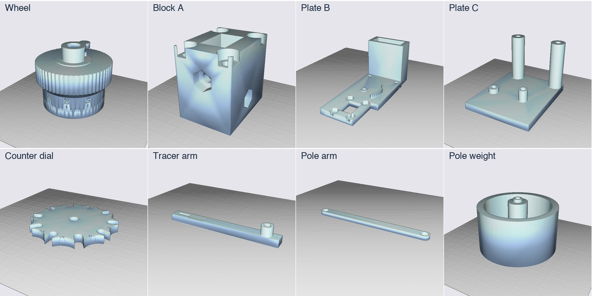

<h1 align="center">Polar Planimeter</h1>

<p align="center">
  A 3D-printable instrument that measures the area of any outline you trace.<br>
  Parametric CadQuery model, STEP and STL files, simulation, and a full write-up of the maths.
</p>

<p align="center">
  <a href="LICENSE"></a>
  
  
  
</p>

<p align="center">
  <a href="#how-it-works">How it works</a> ·
  <a href="#build-it">Build it</a> ·
  <a href="#calibrate-and-use">Use it</a> ·
  <a href="#accuracy-and-limits">Accuracy</a> ·
  <a href="docs/planimeter.pdf">Article (PDF)</a>
</p>

<p align="center">
  
  
</p>

## Overview

Rest the tip on a point of an outline, follow the outline back to the start, and read the area off a small wheel. The design is built around round numbers so that reading it needs no arithmetic:

| | |
|---|---|
| Tracer arm length `L` | 100 mm (adjustable 90 to 110 mm for calibration) |
| Wheel circumference | 100 mm, so one turn is exactly 100 cm² |
| Resolution | 0.2 cm² (50-division drum with a 10-division vernier) |
| Turn counter | Geneva drive, 0 to 9 turns |
| Pole arm | 160 mm between bearings |
| Parts | 9 printed parts, 4 bearings, M3 hardware (42 components in all) |
| Print | PLA, no supports, every part fits a 220 × 220 mm bed (longest part: 173 mm) |

## How it works

A wheel rolls only when it moves sideways to its axle. Mount it on an arm of length `L` that pivots about a fixed pole, and the wheel counts exactly the sideways travel that sweeps out area. Applying Green's theorem to the linkage gives

```
2A = ∮ E×dE  +  2L·s  +  (L² − 2aL) ∮ dθ
```

and with the pole outside the outline, the first and last terms vanish:

```
A = L · s          (s = distance the wheel rolled)
```

The wheel's offset from the arm drops out of the result entirely. The [article](docs/planimeter.pdf) derives this step by step, explains it with everyday analogies, and shows which printed feature carries each term.

<p align="center">
  
</p>

## Build it

### 1. Parts

| Item | Qty |
|---|---|
| 623ZZ bearing (10 × 3 × 4 mm) | 4 |
| M3 bolt: 35 mm ×4, 25 mm ×4, 30 mm ×2, 40 mm ×1 | 11 |
| M3 nut | 12 |
| M3 thumbscrew for the arm clamp | 1 |
| 7 mm washer | 2 |
| Self-adhesive rubber foot | 3 |
| Steel shot or washers for ballast (about 7 g) | 1 |
| Sewing pin (for the check rule) | 1 |

### 2. Print

<p align="center"></p>

PLA, 0.2 mm layers, 3 walls, 20% infill. The STLs in [`stl/`](stl) are already in print orientation, so none needs supports. **Print `tolerance_coupon.stl` first** and, if the bearings, arm or nuts do not fit, adjust `bearing_fit`, `arm_clearance` and `nut_clear` in [`cad/params.py`](cad/params.py), then run `python3 -I cad/build.py`.

### 3. Assemble

1. Press a 623ZZ into each end of the wheel.
2. Pass the M3 × 35 axle through plate C, the wheel and plate B. The wheel must spin freely. Then fix the nut.
3. Screw plate B to block A with four M3 × 25 bolts. Join plates B and C with two M3 × 35 bolts.
4. Fit the counter dial on plate C's boss with the M3 × 30 bolt.
5. Press a bearing into each end of the pole arm. Fix one end to the pole weight and the other to block A.
6. Slide the tracer arm into the channel, set `L = 100 mm` on its scale, and tighten the clamp. Stick the feet under the weight and add ballast to the box on plate B.

The STEP assembly in [`step/`](step) shows every part in its final position. It opens in Fusion 360 through **File → Open** as editable solid bodies, without a parametric timeline.

## Calibrate and use

**Calibrate once.** Pin `check_rule.stl` to a board and rest the tip in its cone seat. The circle it describes has an area of exactly 100 cm². Trace it with the pole outside the circle. If the instrument reads `R_meas`, set the arm length to

```
L_new = L_old × 100 / R_meas
```

and repeat until it reads 100. This also absorbs any error in the wheel diameter.

**Measure.** Keep the pole outside the outline. Note the drum and the dial, trace clockwise, and read again. The area in cm² is the difference. When the dial sits between two digits, take the lower one.

## Accuracy and limits

Simulation puts the worst-case error at about 0.1% per 0.1° of wheel-axle misalignment and about 0.17% for 0.15 mm of play in the elbow. Scale errors from the wheel diameter or arm length are removed by the check rule. A realistic target is **about 0.5% for shapes of 50 to 300 cm²**.

This is a design, not yet a measured result.

- Nothing has been printed and tested on paper. Treat the figures above as predictions.
- The bearing pocket is the tightest fit (1.4× margin at 0.05 mm interference). Use the coupon.
- Wheel load (about 70 g) assumes 50% effective infill, so weigh the real parts and adjust ballast.
- Unlike professional instruments, this one cannot average a reading taken from each side of the pole.

## Repository

```
cad/       CadQuery source. params.py holds every dimension; build.py regenerates everything
stl/       Print-oriented STL for each part
step/      STEP files: one per part, plus planimeter_assembly.step
sim/       Kinematic simulation, error budget, structural hand calculations
docs/      Article (LaTeX source and PDF), figures, sketch video, view renders
tools/     Preview and view renderers, printability report
```

### Reproduce

```bash
pip install -r requirements.txt     # CadQuery needs Python 3.10 to 3.13
python3 -I cad/build.py             # rebuild parts and run assembly checks (42 components, 0 clashes)
python3 -I sim/planimeter_sim.py    # check A = L·s against exact areas
python3 -I tools/printability.py    # watertight, overhang and bed-fit report
cd docs/article && pdflatex planimeter.tex   # run twice for the PDF
```

## License

[MIT](LICENSE)
